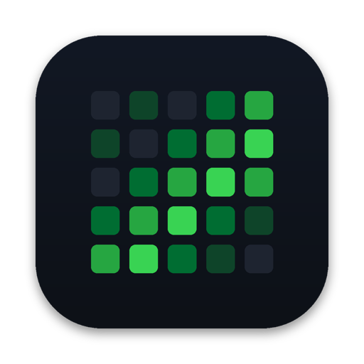

<p align="center">
  
</p>

<h1 align="center">Auxo</h1>

<p align="center">
  All your coding streaks, on your desktop and home screen.<br>
  GitHub, LeetCode and Codeforces heatmaps with your streak, rating and rank, as native widgets for macOS, iPhone and iPad.
</p>

<p align="center">
  <a href="../../actions/workflows/ci.yml"></a>
  
  
  <a href="LICENSE"></a>
</p>

---

## Features

- **Three sources in one place.** GitHub contributions, LeetCode submissions and Codeforces accepted problems, each as a GitHub-style heatmap.
- **Native widgets.** Small, medium, large and extra-large, on the Mac desktop and in Notification Center, and on the iPhone and iPad home screen.
- **Three layouts.**
  - *Single*: one account.
  - *Stacked*: up to three heatmaps.
  - *Combined*: one grid where each day's shade is how many of your accounts were active, so 30 commits don't drown out 2 solved problems.
- **Ratings in the official colors.** Codeforces rating and rank follow the real ladder, from gray Newbie to red Legendary Grandmaster with its black first letter. LeetCode shows the Knight and Guardian badges.
- **Pick exactly what you see.** Each widget has its own account selection, and the app dashboard lets you hide any streak.
- **Share cards.** One tap renders a 1200×630 image of your streak, rank and year, sized for X, LinkedIn and Discord. Usernames are off unless you turn them on.
- **Themes.** Per-source colors, Classic, Ocean, Ember, Mono, or a custom accent. Rank colors never change.
- **Resilient.** Each source syncs on its own. If one site is down, its heatmap shows the last saved data marked as cached, and the others keep working.
- **Private.** No servers, no analytics, no tracking. Data goes straight from each site to your device. The GitHub token lives in your Keychain.

## Requirements

- macOS 14 Sonoma or later (desktop widgets need Sonoma), or iOS / iPadOS 17 or later
- Xcode 16 or later
- [XcodeGen](https://github.com/yonaskolb/XcodeGen): `brew install xcodegen`

## Build and run

```bash
git clone https://github.com/Siddharth543/Auxo.git
cd Auxo
cp Config/Local.xcconfig.template Config/Local.xcconfig
open -e Config/Local.xcconfig     # set AUXO_BUNDLE_PREFIX and DEVELOPMENT_TEAM
xcodegen generate
open Auxo.xcodeproj
```

In Xcode, choose the **Auxo-macOS** or **Auxo-iOS** scheme and press **⌘R**.

### Settings in `Config/Local.xcconfig`

| Setting | What to put | Why it's needed |
|---|---|---|
| `AUXO_BUNDLE_PREFIX` | Something unique to you, like `com.yourname` | Bundle IDs and the App Group are built from it. |
| `DEVELOPMENT_TEAM` | Your 10-character Team ID, from Xcode › Settings › Accounts | Signing. The App Group that lets the widget see the app's data needs a team. |
| `AUXO_GITHUB_CLIENT_ID` | Optional. A GitHub OAuth App client ID | Enables "Sign in with GitHub". Without it, users paste a token instead. |

> **Free vs paid Apple accounts.** On the Mac, a free Personal Team is enough. On iPhone and iPad, sharing data between the app and its widget uses an App Group, which needs a paid Apple Developer membership. Without one, the iOS app runs but the widget can't see your accounts.

### Add the widget

- **Mac:** right-click the desktop, choose **Edit Widgets…**, search "Auxo", and drag it out.
- **iPhone / iPad:** long-press the home screen, tap **+**, and search "Auxo".

To choose what a widget shows, right-click it on the Mac (or long-press it on iPhone and iPad) and choose **Edit "Auxo"**. Pick a layout and the accounts it should show.

## GitHub sign-in

GitHub only shares contribution calendars with signed-in apps, even for public profiles. Auxo asks for **no permissions**. The token can read public profile data only, and it is stored in your Keychain.

Auxo offers two ways to sign in:

1. **Sign in with GitHub (device flow).** You enter a short code at github.com/login/device. This needs `AUXO_GITHUB_CLIENT_ID` to be set up:
   - Create an OAuth App at [github.com/settings/developers](https://github.com/settings/developers). Any homepage and callback URL will do.
   - Tick **Enable Device Flow**.
   - Copy the client ID into `Config/Local.xcconfig`. The client ID is public by design, so it's safe in a fork.
2. **Personal access token.** Create a [fine-grained token](https://github.com/settings/personal-access-tokens/new) with "Public repositories" access and no permissions, then paste it into the app.

Private contributions are counted only if you've turned on *Include private contributions on my profile* in your GitHub settings.

## Data sources

| Source | Endpoint | Official? | Rating |
|---|---|---|---|
| GitHub | GraphQL `contributionCalendar` | Yes | — |
| Codeforces | `user.info`, `user.rating`, `user.status` | Yes | Rating, max rating, rank, contests |
| LeetCode | `leetcode.com/graphql` (used by its own website) | **No** | Contest rating, badge, top % |

LeetCode has no public API. If LeetCode changes its endpoint, the LeetCode heatmap shows cached data and an "Unavailable" label until Auxo is updated. Please [open a "source broke" issue](../../issues/new/choose) if you see that.

Widgets refresh about every 30 minutes, and just after midnight. macOS and iOS decide the exact moment. The ↻ button on a widget refreshes it right away.

## Project layout

```
Packages/AuxoKit/      Swift package with all logic, unit-tested on CI
  AuxoCore/            models, streak math, shared storage, Keychain
  AuxoProviders/       GitHub, LeetCode and Codeforces integrations and sync
  AuxoUI/              heatmap, rank colors, themes, share card (shared by app and widget)
App/                   SwiftUI app for macOS and iOS
Widget/                WidgetKit extension for macOS and iOS
Config/                build settings, privacy manifest
project.yml            XcodeGen spec (the .xcodeproj is generated)
```

[docs/ARCHITECTURE.md](docs/ARCHITECTURE.md) explains how the pieces fit together. [docs/ADDING_A_SOURCE.md](docs/ADDING_A_SOURCE.md) walks through adding a site such as AtCoder or CodeChef.

## Contributing

Contributions are welcome. New sources are the most wanted. See [CONTRIBUTING.md](CONTRIBUTING.md).

```bash
swift test --package-path Packages/AuxoKit   # run the unit tests
```

## License

[MIT](LICENSE) © 2026 Siddharth Sengupta

Auxo is not affiliated with GitHub, LeetCode or Codeforces. Their names are used only to describe the data Auxo can display.
